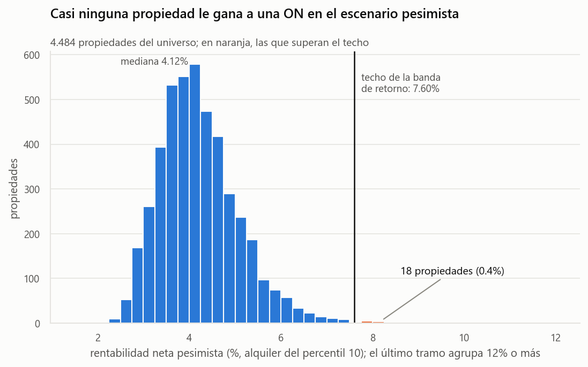
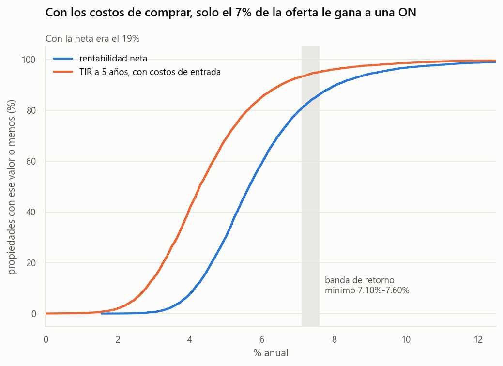
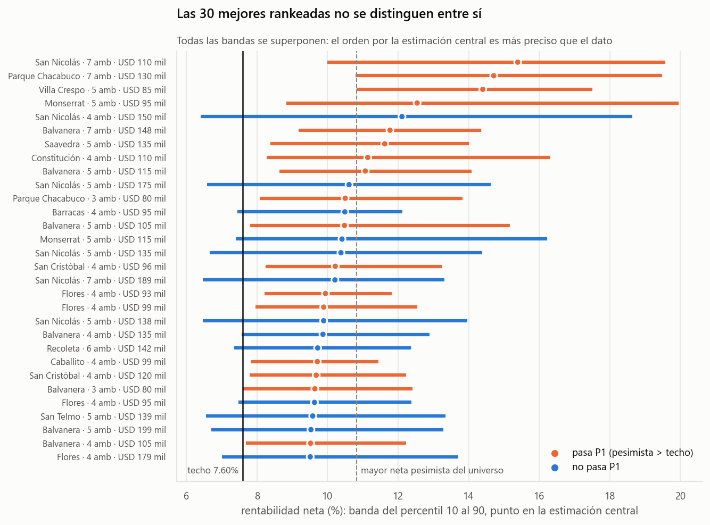
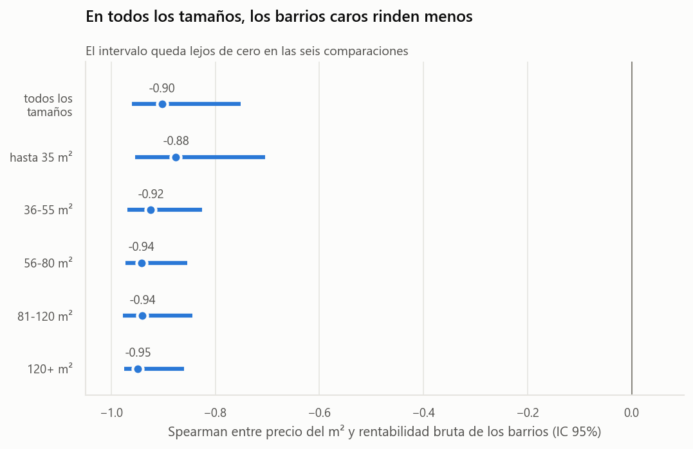
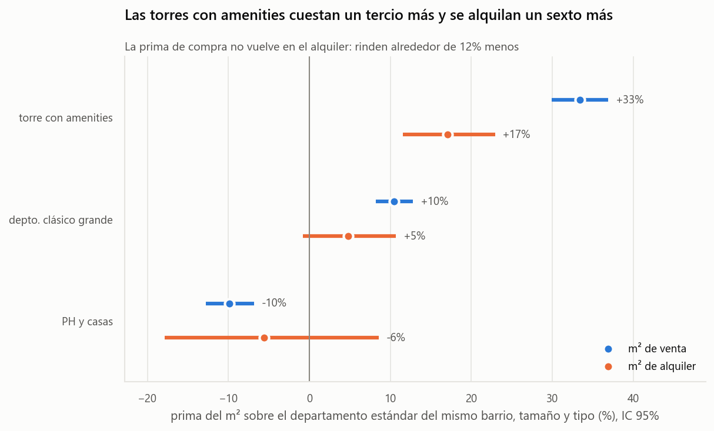
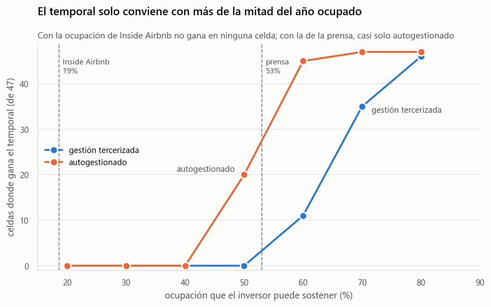
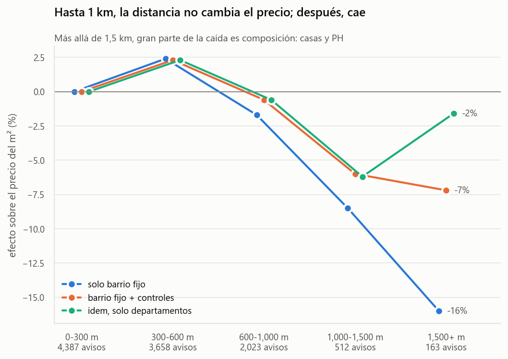

# Informe de hallazgos — 3ra pre-entrega

**TP Integrador · 82.04 Analítica Descriptiva (ITBA) · Grupo 2**

*Generado por `py src/reporte.py` el 29-10-2026. Cada cifra de este documento se calcula al generarlo a partir de `data/processed/` y `data/external/`: si se reejecuta el pipeline, el informe se regenera con los números nuevos.*

**Cliente:** un pequeño inversor con ahorros en dólares que compra **una sola unidad** en CABA para alquilarla, con un presupuesto de USD 80.000 a USD 200.000 y un horizonte de 5 años. **Base:** 9.203 departamentos, casas y PH en venta de la cartera de RE/MAX, relevados entre el 16-08-2026 y el 17-08-2026, con alquiler estimado confiable. **Vara:** la banda de retorno mínimo de las obligaciones negociables corporativas en dólares (YPF 2031 y Pampa 2037), de **7,10% a 7,60%**.

Los hallazgos van ordenados por cuánto cambian la decisión del inversor, y cada uno cierra con la decisión que modifica. Solo quedan los que la cambian.

---

## 1. Para la propiedad típica, la decisión es no comprar

La rentabilidad **neta** mediana es **5,65%**, 1,45 pp por debajo del piso de la banda. Solo el 19,4% de las propiedades lo supera, y eso con la estimación central del alquiler.

La función de decisión (P1) es más exigente, como se declaró en la 2da entrega: recomienda comprar solo si la neta del **escenario pesimista** (el alquiler del percentil 10 de la banda de cada propiedad) supera el **techo** de la banda. Sobre las 4.484 propiedades del universo de la decisión (dentro del presupuesto, con estimación confiable y en el soporte del modelo):

| | Propiedades | % del universo |
|---|---|---|
| Neta central sobre el techo | 227 | 5,1% |
| **Neta pesimista sobre el techo (P1)** | **18** | **0,4%** |
| TIR pesimista a 5 años, con costos de entrada, sobre el techo | 4 | 0,09% |

**Las que pasan son baratas para su celda.** Su m² cuesta una mediana de 0,69 veces el mediano de su barrio y tramo de superficie. Puede ser una oportunidad o algo que el aviso no dice (estado, uso, ubicación): la función las señala para verificar, no para comprar a ciegas.

**El soporte del modelo.** El universo excluye 714 propiedades dentro del presupuesto, todas PH y casas. Hay 14 alquileres observados de casas y 44 de PH, contra 1.290 de departamentos, y sin ese filtro la primera recomendación era una casa de 9 ambientes con un alquiler extrapolado de más de USD 5.000. Las casas y los PH no se pueden recomendar con estos datos.

**Es robusto.** En los 22 escenarios de sensibilidad (vacancia, gastos, ABL, costos de entrada, banda de retorno y margen por liquidez), las que pasan P1 van de 3 a 51. Con costos de entrada, nunca más de 5. Lo que se mueve es la lista: con un margen por liquidez de 1 punto pasan 6, y con el piso de la banda en lugar del techo, 33.

**Tampoco lo resuelve el horizonte.** Con un repago mediano de 171 meses, en 5 años el alquiler devuelve el 35% del precio. El resto depende de revender, en un mercado donde en 2025 solo el 19,1% de las compraventas de la Ciudad se hizo con hipoteca, y donde en el 2do trimestre de 2026 un aviso pasaba en promedio 298 días publicado, unos 9,8 meses (IDECBA, toda la Ciudad).

> **Decisión que cambia.** La respuesta a "¿compro para alquilar?" es **no** para la propiedad típica: la renta fija en dólares le gana en retorno, liquidez y riesgo de gestión. Comprar se justifica solo para las pocas unidades que superan el techo aun en el escenario pesimista, después de verificar por qué son baratas, o como una apuesta explícita a la revalorización, declarada como tal.

## 2. Con los costos de comprar, la distancia a la renta fija pasa de 1,45 a 2,83 puntos

Comprar cuesta una mediana de **5,55% del precio** entre comisión, escribano, registrales y la mitad del Impuesto de Sellos (piso de cada rango publicado). Se pagan una vez y no vuelven al vender, así que la cifra comparable con una ON es la **TIR a 5 años**, que los incluye.

| | Mediana | Barrios sobre el piso |
|---|---|---|
| Neta, ABL plano (2da entrega) | 5,67% | 1 |
| Neta, ABL segmentado | 5,65% | 1 |
| **TIR a 5 años, ABL segmentado + costos de entrada** | **4,27%** | **0** |

El **ABL segmentado** (Ley Tarifaria 2026, por barrio, superficie y tipo) casi no mueve el nivel, pero redistribuye: pesa 4,65% del alquiler en el quintil que menos rinde y 3,19% en el que más, contra un 3,80% plano para todos. Los **costos de entrada** sí mueven la conclusión: la distancia de la mediana al piso pasa de 1,45 pp a 2,83 pp.

**La refacción.** Las unidades a reciclar cotizan con descuento (H3, hallazgo 4), equivalente a 30,3% del precio de la unidad. Una refacción mínima (baño, cocina, pintura) cuesta una mediana de 13,5% y el descuento la cubre en el 94% de las unidades; una integral cuesta 83,4% y no la cubre en ninguna.

> **Decisión que cambia.** El hallazgo 1 era optimista: sin los costos de entrada, la renta parecía más cerca de la ON de lo que está. Ningún barrio supera el piso a cinco años. Una unidad a reciclar es oportunidad solo si la obra es menor.

## 3. No hay una "mejor propiedad": la banda de error no deja elegir

El modelo de alquiler (Ridge, 21 predictoras) le gana con claridad a una referencia simple, la mediana del barrio y el tramo de superficie: R² de 0,847 contra 0,750, y error relativo mediano de 11,4% contra 15,0%, fuera de muestra en tres semillas. Ninguna alternativa le gana a él (la mejor llega a 0,847). Su banda del percentil 10 al 90 cubre el 81,6% de los alquileres observados fuera de muestra; la de la 2da entrega cubría el 50,1%.

Con esa banda, P2 recomienda A sobre B solo si la neta pesimista de A supera la optimista de B. **Eso pasa en el 7,2% de los pares**, en el 5,2% si se comparan unidades del mismo tramo de superficie y en el 3,7% dentro del mismo barrio. En los 22 escenarios de sensibilidad queda entre 7,0% y 8,1%.

Ninguna propiedad supera con claridad a otras 140, que forman la **frontera** de P2. Entre ellas ninguna se distingue de otra, y pesan los barrios de m² barato (Balvanera, San Nicolás y Monserrat). Su banda mediana es de 5,66 pp, contra 2,67 pp en el universo: parte de la frontera está ahí porque el modelo sabe poco de esas propiedades, no porque rindan más. La liquidez no desempata: el tiempo de publicación de IDECBA va de 286 a 303 días entre 1 y 4 ambientes (349 con 5 o más), y no existe por barrio.

> **Decisión que cambia.** P2 no devuelve "la mejor propiedad" sino una lista corta. Un ranking propiedad por propiedad sería más preciso que el dato que lo sostiene. Dentro de la lista, el criterio que informa es el **ancho de la banda**: entre dos candidatas, la de banda más angosta tiene una rentabilidad que se conoce mejor.

## 4. Qué rinde más, comparando propiedades semejantes

Los cuatro tests declarados en la 2da entrega, con α = 0,05 fijado antes de correrlos. Con miles de observaciones casi todo es significativo, así que cada uno se lee por el tamaño del efecto y por si cambia la decisión.

- **El barrio es la palanca más fuerte (H1).** Cada USD 500 más de m² del barrio resta 0,98 pp de rentabilidad bruta (IC 95% [-1,16 pp, -0,81 pp]; Spearman -0,90 sobre 29 barrios, p < 0,001). Se sostiene en 5 de 5 tramos de superficie, después de corregir por comparaciones múltiples.
- **Las torres nuevas con amenities rinden menos.** La síntesis de atributos (PCA y MCA) separa la oferta en cuatro micro-mercados. Contra un departamento estándar del mismo barrio, tamaño y tipo, la "torre con amenities" (19% de los avisos) cuesta +33% por m² (IC [30%, 37%]) y se alquila +17% (IC [12%, 23%]): unos 0,9 pp menos de bruta. Se mide con precios y alquileres publicados, no con la rentabilidad estimada.
- **A reciclar: descuento real, oportunidad condicionada (H3).** Cotizan -23,3% por m² contra sus comparables (IC [-26,8%, -19,2%], p < 0,001) y rinden +1,12 pp de bruta (IC [0,74 pp, 1,52 pp]). Ver la refacción en el hallazgo 2.
- **Lo viejo rinde algo más, pero poco (H4).** Cada década de antigüedad baja el m² de venta 5,7% y el alquiler 2,6% (p < 0,001): +0,23 pp de bruta por década, menos de un punto en 40 años.

> **Decisión que cambia.** Dentro del presupuesto, buscar en barrios de m² barato y evitar las torres nuevas con amenities: lo que se paga de más al comprar no vuelve en el alquiler. Pagar amenities es una decisión de consumo, no de inversión. Las unidades a reciclar valen la pena solo con obra menor.

## 5. Alquilar por noche no rescata la inversión, salvo autogestionado

Neta contra neta, en 47 celdas de barrio y dormitorios. La **ocupación de equilibrio**, con la que el temporal empata al tradicional, tiene una mediana de **65,5%** con gestión tercerizada y 51,7% autogestionado. Con la ocupación que estima Inside Airbnb (18,6% de mediana) el temporal gana en 0 celdas. Con el 53% que informa la prensa, gana en 2 con gestión tercerizada y en 28 autogestionado.

> **Decisión que cambia (P3).** Tradicional, salvo para un inversor que opere el temporal por su cuenta y tenga evidencia de poder sostener más de la mitad del año ocupado. Autogestionar es un trabajo, no un ahorro, y las dos ocupaciones de referencia son estimaciones.

## 6. La cartera de RE/MAX publica más barato que el mercado

Contra el precio publicado del m² de IDECBA en la misma celda de barrio, ambientes y estado, RE/MAX publica más barato en el 94% de 135 celdas: -8,0% en promedio ponderado (-9,0% en usados, -17,2% a estrenar). La cartera sobrerrepresenta la comuna 1 y subrepresenta las comunas 4, 8 y 9 contra el stock del Censo 2022. Comprando al precio promedio del mercado, la neta mediana bajaría de 5,65% a alrededor de 5,20%.

> **Decisión que cambia.** Los niveles de rentabilidad son los de la cartera, no los de CABA, y probablemente están del lado alto: la brecha contra la renta fija del hallazgo 1 es, si algo, mayor. El análisis sirve para **comparar** propiedades, no para prometer una rentabilidad.

## 7. La cercanía al transporte ya está en el precio del barrio (H2, reformulada)

Con subte, tren y Metrobús, el 88,4% de los avisos tiene una estación a menos de 800 m, contra el 62,2% con el subte solo. En las comunas 8 y 11, sin ninguna boca de subte a esa distancia, la red combinada llega a entre el 72% y el 75%.

Dentro del mismo barrio y con controles del inmueble, la pendiente lineal del m² con la distancia **no es significativa** (-3,2% por km, p 0,081, errores agrupados por barrio). Lo que sí aparece es un escalón: **más allá de 1 km de la red, el m² vale 6,7% menos** (IC [-10,9%, -2,3%], p 0,002). Afecta al 6% de los avisos.

> **Decisión que cambia, poco.** Dentro de su barrio, el inversor no tiene que pagar una prima por estar al lado de una estación: hasta 1 km la distancia no se paga. Lejos de la red hay un descuento chico en pocos avisos, y el modelo de alquiler no muestra que el alquiler caiga en la misma proporción.

## Estado de las hipótesis

| Hipótesis | Test | Resultado | Efecto (IC 95%) | ¿Cambia la decisión? |
|---|---|---|---|---|
| **H1.** La rentabilidad cae con el precio del m² del barrio | Spearman con permutación; por tramo con Holm | Se sostiene (p < 0,001) | -0,98 pp por USD 500/m² [-1,16, -0,81] | Sí |
| **H2.** El m² cae con la distancia al transporte | Efectos fijos de barrio, errores agrupados | Lineal: no (p 0,081). Escalón a 1 km: sí (p 0,002). **Se reformula** | -6,7% [-10,9%, -2,3%] | Poco |
| **H3.** Las unidades a reciclar cotizan con descuento | Van Elteren por celda barrio × superficie | Se sostiene (p < 0,001) | -23,3% del m² [-26,8%, -19,2%] | Sí, con obra menor |
| **H4.** La antigüedad pesa más en venta que en alquiler | Wald, bootstrap por celdas | Se sostiene (p < 0,001) | +0,23 pp de bruta por década | Poco |

Desarrollo completo en `notebooks/04_validacion.ipynb`.

## Qué hallazgos de la 2da entrega no siguen

- **El mapa por zonas (norte, centro, sur y oeste).** Lo resume H1, que lo contrasta formalmente y en unidades del inversor.
- **La dispersión dentro de cada barrio.** Era el argumento para comparar unidades y no barrios. Ahora lo responde P2 con la banda de cada propiedad (hallazgo 3).
- **Las unidades chicas rinden más.** No tiene contraste formal, y la frontera de P2 muestra que el tamaño se confunde con la incertidumbre del modelo en las unidades grandes. No cambia la decisión de forma defendible.

## Lo que este informe no permite afirmar

- **Precios de cierre.** Todos los precios son de publicación, del lado de la venta y del alquiler.
- **El mercado de CABA.** Se describe la cartera de una red inmobiliaria, con el sesgo del hallazgo 6.
- **Una rentabilidad exacta.** Cada estimación tiene su banda: los KPIs por propiedad son rangos.
- **Casas y PH.** Quedan fuera de las recomendaciones: el modelo casi no tiene alquileres observados de ellos.
- **Retorno total.** Solo se mide renta; la apreciación requiere una serie temporal. La TIR supone reventa al mismo precio en dólares y no incluye costos de salida.
- **Riesgo legal.** Desalojos, impagos y cambios de régimen no tienen una fuente que los cuantifique: es una limitación declarada y todo resultado es optimista en esa medida.
- **Liquidez por propiedad.** El tiempo de publicación es de toda la Ciudad, por cantidad de ambientes.
- **Causalidad.** Comparar dentro del estrato controla por zona, tamaño y tipología, no por todo.

Los supuestos están en `src/supuestos.py` con su fuente y fecha, y las fuentes externas en `informe/FUENTES_EXTERNAS.md`. Cada hallazgo se desarrolla en los notebooks 01 a 06.
